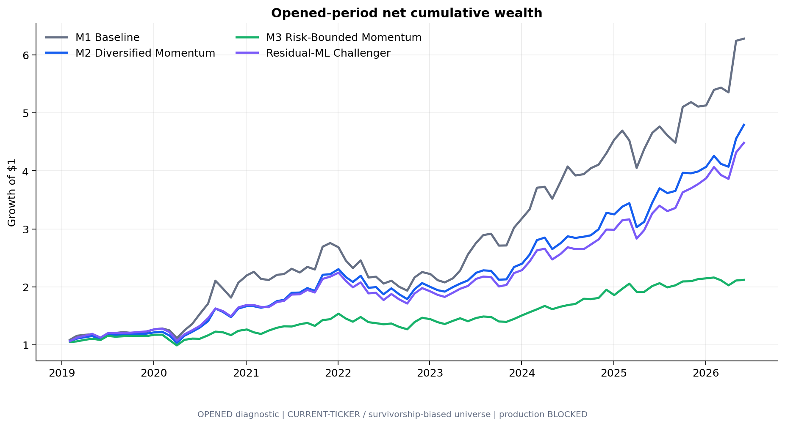
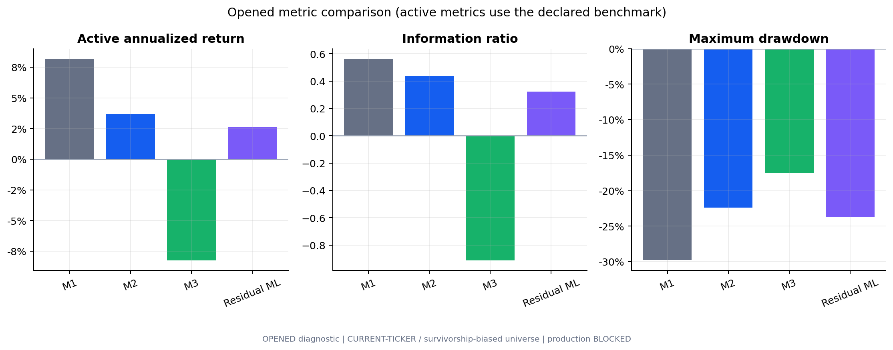
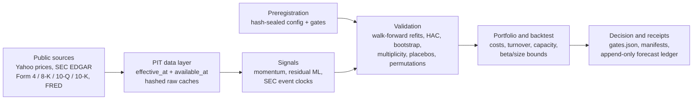

# Alpha Engine

**Does a monthly US-equity signal still deliver alpha once timing, costs, multiple testing, and a preregistered decision rule are enforced?**

  

## Research question

Backtests of cross-sectional equity signals are easy to make look good: look-ahead in filing timestamps, survivorship in the universe, unpriced turnover, and silent re-testing all inflate results. This project builds a point-in-time research engine in which every observation carries both an `effective_at` and an `available_at` clock, every hypothesis is preregistered with hash-sealed governance receipts, and a candidate is promoted only if it clears statistical gates fixed in advance. It then applies the engine to price momentum, a nonlinear ML overlay, and several SEC-filing event families (Form 4 insider purchases, 8-K Item 2.02 reactions, 10-Q earnings changes, 10-K reporting lags).

## Key findings

- **Diversified momentum (M2) is the frozen champion: Sharpe 1.23 and 23.5% annualized net return** over 89 monthly holding periods (Feb 2019 – Jun 2026), cutting maximum drawdown from -29.8% to -22.4% and halving turnover (62% → 31%) relative to concentrated top-6 momentum.
- **The decision rule held.** M2 still misses the preregistered gates (active return 3.69% vs a 4% hurdle, information ratio 0.44 vs 0.50, and a post-search t-statistic below 3.0), so the engine records it as a prospective champion rather than validated alpha. It is now tracked in an append-only, hash-chained forecast ledger that requires 36 sealed monthly decisions before any promotion.
- **The ML overlay is rejected on evidence.** An 80/20 momentum / residual-ML rank blend (Ridge + Extra Trees + histogram GBDT ensemble on beta/size-residual returns) subtracts 1.05% per year versus M2, with a Newey-West t-statistic of -0.91 and a bootstrap-Sharpe 5th percentile of -0.74. A standalone nonlinear model loses 12.3% per year versus momentum (t = -2.08).
- **SEC event drift does not survive costs.** On 15,373 scheduled 8-K Item 2.02 events, reaction drift is already negative before costs (-0.06% per 20 sessions) and -0.66% net at 30 bps (HAC t = -3.85). A 10-Q seasonal earnings-change signal earns +0.30% gross but -0.30% net, and a pre-event placebo exceeds the post-event effect, pointing to information-clock rather than drift. An independent re-implementation reproduced 2,814 / 2,814 lineage, clock, return, and inference checks.
- **Governance catches process errors, not just weak signals.** For a 25,965-filing Form 4 insider-purchase census, the engine's own receipts showed the candidate census was generated before the protocol was frozen, so it automatically marked the study as not validly preregistered and kept all return outcomes unopened.

<p align="center">
  
</p>
<p align="center">
  
</p>

## Approach

Each study is defined by a versioned config and a preregistration file whose SHA-256 is sealed before outcomes are read. Data adapters stamp every record with the time it describes and the time it became knowable (SEC acceptance time, a close-plus-30-minute lag for prices, a one-day lag for FRED); as-of joins admit only `available_at <= decision_time`. Signals are formed at 20:00 ET month-end and executed at the next 09:30 ET open on an exchange calendar snapshot. Models refit on an annual expanding window using only labels whose exit precedes the refit cutoff. Portfolios charge turnover against drifted weights, initial entry, and terminal liquidation, and are screened for $10m-AUM capacity. Inference uses Newey-West HAC t-statistics, moving-block bootstrap, multiplicity adjustment over all disclosed trials, label permutations, and random sub-universes.



## Repository layout

| Path | Contents |
|---|---|
| `src/alpha_factor_engine/data/` | Point-in-time adapters: Yahoo, SEC EDGAR (facts, filings, Form 4, 8-K items), FRED/ALFRED, MarketData, and fail-closed schemas for licensed CRSP / Compustat / I/B/E/S / TAQ / options / borrow files |
| `src/alpha_factor_engine/features/` | Price, fundamental, macro, filing-change, and text feature builders |
| `src/alpha_factor_engine/research/` | Momentum and diversified momentum, residual-ML overlay, champion/challenger evaluation, SEC event studies, governance (preregistration, sealed ledger), metrics and inference |
| `src/alpha_factor_engine/*pipeline.py` | End-to-end public-research, champion/challenger v1 and v2, and broad-universe pipelines; `cli.py` is the entry point |
| `proxy_research/` | Broad 1,500-name public proxy universe: acquisition, panel build, model, random-universe and label-permutation robustness |
| `scripts/` | Runners, design/freeze receipt builders, independent audit and verifier scripts for each study |
| `configs/` | Versioned study configs and preregistrations (YAML / JSON) |
| `governance/` | Sealed preregistration, trial, and forecast-ledger receipts for champion/challenger v1 and v2 |
| `tests/` | 61 test modules (438 tests): as-of joins, look-ahead rejection, execution clocks, turnover, capacity, immutable ledgers, event-study timing |
| `artifacts/reference_calendars/` | Frozen NYSE regular-session calendar 2014–2028 with its generation receipt |
| `docs/` | Literature review and data-layer / point-in-time contract |
| `paper/`, `figures/` | Companion paper and key charts |

## Reproducing

```bash
python3 -m venv .venv && source .venv/bin/activate
python -m pip install -e ".[dev]"
python -m pytest            # 438 passed, 4 skipped (skips need generated artifacts)
```

Offline Form 4 event-study demo on a synthetic bundle (no network):

```bash
python scripts/build_form4_synthetic_fixture.py --bundle-dir /tmp/f4/bundle --output-dir /tmp/f4/out
```

Full studies on public data (downloads are cached under `data/cache/`, outputs go to `artifacts/`):

```bash
export SEC_USER_AGENT="YourName your-email@example.com"   # required by SEC EDGAR
alpha-factor public-research        --config configs/public_research.yml
alpha-factor champion-challenger-v2 --config configs/champion_challenger_v2.yml
```

See `.env.example` for optional variables (`FRED_API_KEY` for ALFRED vintages, `MARKETDATA_TOKEN`, licensed-data roots). No vendor or licensed data is redistributed; the licensed adapters validate schemas and point-in-time columns only (`alpha-factor validate-licensed --source crsp --path <file>`). Generated outputs and the sealed source bundles referenced in `governance/*/SOURCE_SNAPSHOT.md` are kept out of the repository for size.

## Paper / report

[`paper/alpha_engine_research_paper.pdf`](paper/alpha_engine_research_paper.pdf) documents the first-stage walk-forward study on a fixed 30-stock universe (equal-weight, momentum, defensive ML, blended, and long-short ML portfolios) that motivated the engine. Its central result, that simple momentum dominates and an ML label does not by itself deliver neutral, robust alpha, is what the champion/challenger and preregistration layers here were built to test under stricter controls. The [literature review](docs/literature_review.md) covers factor mechanisms, nonlinear ML in asset pricing, replication decay, and validation design.

## Author

Siyan Chen · University of California, Santa Barbara · siyan_chen@ucsb.edu
